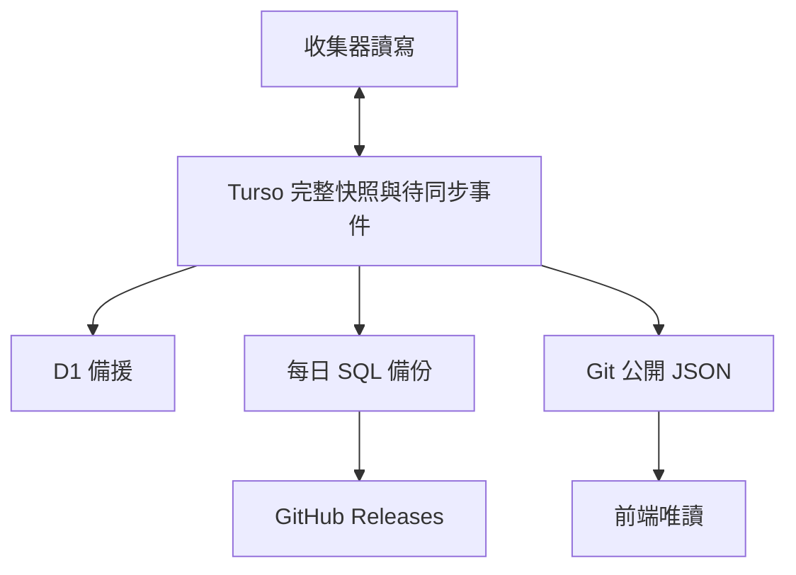

# 遊戲雷達資料庫與備份維運

## 目前整合邊界

主庫模式的資料流是 **收集器 → Turso 讀寫 → Git 公開投影與 D1 非同步備援**。
切換由 `Coordinate database primary cutover` 控制；部署程式不等於已切換。
以成功的 cutover 報告、七個來源的 primary policy 與各 runtime 的
`RADAR_DATABASE_PRIMARY=1` 為準。尚未切換的來源仍按原本 Git 匯入流程運作。
瀏覽器只讀靜態 JSON，資料庫 Token 僅注入 Actions 後端工作。
D1 不會自動升為另一個寫入來源；主庫故障時保留最後成功的公開資料。

這個邊界保留既有 Followers / growth 的三方合併、較新量測優先及 Git 發布回執。
資料庫操作使用跨 repository 的短期租約與 fencing，外部收集與 D1 網路等待不占用主庫租約。



## 完整來源

來源選取規則在 `radar_core/storage/sources.py`，初始匯入固定 Git commit 並保存完整 bytes。
啟用主庫後不再從 Git 覆蓋該來源。來源包含 JSON、JSONL、NDJSON。

| Repository / branch | 範圍 |
| --- | --- |
| `game-trend-radar` / main | `data/` 全部；含成長歷史、Twitch 每日歷史、Nintendo、YouTube、公開頁面資料 |
| `game-trend-radar-backend` / main | `data/`、`experiments/`、`reports/` |
| `game-trend-radar-backend` / steam-state | `data/`；另一路 Followers checkpoint |
| `game-trend-radar-content-backend` / main | `data/`、人工 `content_backend/descriptions_zh_tw.json` |
| `game-trend-radar-igdb-backend` / main | 保留遷移前 `data/` 鏡像；主庫模式的新 IGDB master、catalog 與回條統一寫入 frontend namespace |
| `game-trend-radar-twitch-backend` / main | `data/` 全部 |
| `game-trend-radar-youtube-backend` / main | 監看 `data/`；初始無資料檔，實際公開輸出已包含於 frontend |

2026-10-15 固定來源盤點：245 檔，原始 280,689,473 bytes；實際儲存的
gzip/base64 去重 chunks 約 39.4 MB，另外加上索引、來源清單與同步紀錄。
這是基準量測，線上資料會持續增加。沒有刪除 Twitch 歷史或縮減 IGDB 原始資料。

## 如何維持完整性

- 檔案保持原始 bytes，不經解析後重寫；中文、未知欄位、大型 ID 與格式均可還原。
- 壓縮內容以 SHA-256 定址、去重並分塊，每列低於 48 KiB。
- 同一來源的所有檔案先保存、讀回驗證，最後才以單一 CAS SQL 更新來源清單。
  SQLite trigger 在同一個交易中產生待同步事件，避免只有主資料而沒有同步紀錄。
- D1 必須讀回並驗證完整資料後才確認同步成功。失敗事件保留，後續重試可重複執行。
- 來源下載、JSON 驗證或 Git 讀取失敗時，保留上一份快照，不將失敗解讀為刪除。
- 清理只回收不被現行來源、待同步、待發布或保留證據引用的資料；完整歷史檔仍在來源中。
- schema v2 的遠端租約與 DB trigger 阻擋過期 writer、舊版 Git 匯入及不合法清理。
  workflow concurrency 僅負責單一排程，跨 repo 安全性由資料庫保證。
- CAS 衝突重新讀取主庫並重播固定觀測；API 不重查、觀測時間不改寫。
- DB 保存成功與 Git push 成功分開記錄。Git 失敗保留 pending，維運工作補發布；
  `published_revision` 永遠是真 Git SHA。IGDB 的 `persisted` 回條僅表示 DB 已保存。

資料表是可攜式 SQLite 文件儲存：`radar_sources` 為來源版本，`radar_objects` /
`radar_chunks` 保存內容，`radar_outbox` 保存待同步事件，`radar_revisions` 防止同一
Git 版本被賦予不同內容。`radar_schema` 記錄 schema 版本；v2 另有來源權限、租約、
operations、projections 與 evidence，保存冪等寫入、真實發布回執及歷史收錄證據。
這不是供前端直接 SQL 查詢的正規化遊戲資料表；前端繼續讀靜態 JSON。

## 排程與故障

Actions workflow：**Sync radar data to Turso and D1**。

- 每小時第 43 分執行備援與維運；GitHub 排程可能延遲，不是準點保證。
- Steam 每日候選、官方 Followers、成長追蹤完成後也掃描，包括有保存進度的失敗 run。
- 主庫模式的跨 repo 更新直接提交 Turso，D1 由維運工作追上。
- 不依賴 `GITHUB_TOKEN` 提交觸發 push；這類提交通常不會建立後續 push workflow。
- HTTP 每次最多 15 秒、最多 3 次；維運 job 上限 45 分鐘。
- 每日備份先於 D1 同步執行，避免 D1 故障拖延主庫的獨立備份。
- 收集器必須確認 Turso 已保存才宣告保存成功，主庫錯誤會中止該工作，不以 Git 舊資料代替。
- D1 失敗不回滾 Turso；待同步事件保留。Git 補發布每輪最多 8 分鐘、每來源 3 次，
  未成功 push 不確認 ACK；失敗不使後續排程無限等待。

報告包含每個來源 commit / generation、同步 pending 數、主備一致性、容量與備份結果。
`events_pending = 0` 代表當輪已保存於 Turso 的事件都已同步，不代表跨來源同時刻的全域交易。
各 repo 的快照有各自擷取時間；不偽稱同一瞬間的全系統狀態。

手動 `Run workflow` 模式：

| mode | 用途 |
| --- | --- |
| `sync` | 匯入尚未啟用主庫的來源、補同步 D1、清理孤兒資料 |
| `replicate` | 不重新收集 Git，重試已有的 D1 待同步事件 |
| `verify` | 要求完整 7 個來源，逐來源還原主備資料並比對原始 bytes |
| `export` | 匯出現在的 Turso 快照，額外提供保留 1 天的下載 artifact |

五個 repository Actions Secrets 沿用 `docs/turso-d1-rollout.md`。
Turso 兩個 secrets 亦需配置到 frontend Actions、Twitch、Content 與 YouTube runtime；
IGDB 由 Twitch workflow 執行。`prepare` 只使用既有具權限的 Token，將固定兩個 Secrets
以各目的 repo 的 public key 加密後寫入；不輸出明文。缺少權限時停止並回報，不繞過權限。
GitHub Releases 使用 Actions 自帶的 `GITHUB_TOKEN`，不用再建立另一個 Token。

## 每日可攜式備份與還原

每個台灣日期第一個成功備份會建立 GitHub Release：`radar-storage-v1-YYYY-MM-DD`。
內含 `radar.sql.gz`、`manifest.json`、`SHA256SUMS`。SQL 是標準 SQLite SQL dump，
不依賴 Turso 帳戶；發布前先匯入新的 SQLite 檔、執行 integrity check，再驗證全部文件。
同日已完成版本不覆蓋；歷史 release 不自動刪除。這些來源原已是公開 Git 資料，備份也公開。
大量 SQL 備份放在 Releases；一般 Actions artifact 只保留小型狀態報告，避免日常佔用大量 artifact 空間。

下載備份後，在本 repo 根目錄可使用 Python 3.12 還原原始 JSON：

```bash
python -m scripts.storage_restore --sql-gzip radar.sql.gz --output restored-data
```

也可以先還原成標準 SQLite，再用任何 SQLite 工具存取；`storage_restore` 亦支援
`--sqlite radar.sqlite`。輸出目錄必須尚不存在，避免蓋掉目前資料。
工具驗證 SHA-256 與原始長度後才產生最終目錄，每個來源有獨立子目錄與還原清單。
不會執行供應商切換或部署操作。

Turso 永久無法使用時，可先取得最新 GitHub Release 或使用 D1 中已同步的資料；
重新部署與將 D1 升為收集器主來源需要另行切換 writer，不能只換 URL。

## 免費容量與後續維護

D1 Free 目前單庫 500 MB、每日 100,000 rows written，索引更新也計入寫入量。
此版使用增量去重與孤兒回收，沒有啟用任何付費方案。
chunk payload 達 300 MiB 時，workflow 會明確回報容量警示並失敗提示；該數字未包含索引等額外空間，
應同時查看 Cloudflare 控制台實際容量。到達警示時需先規劃分庫，不能靠自動刪歷史維持備援。

10/08–10/14 的 6 個完整 Twitch 日期，觀測平均每日約增加 1.84 MB gzip/base64；
若覆蓋量不變，30 天約 55 MB。這只是既有資料的推估，免費容量不是永久無限。
未來可以利用 D1 免費多庫額度分開歷史與即時資料，但本版尚未實作自動分庫。

擴大來源 prefix 或新增資料類型時，需做來源 scope 版本遷移；不能直接讓相同 Git commit
指向不同 manifest。資料表升級亦需明確 schema migration，未知版本會拒絕執行。

## 正式切換與重試

1. 先部署所有 repo，primary 開關保留 0；外部 repo 固定同一個 immutable core SHA。
2. `prepare` 配置 runtime secrets，既有開關不重設。
3. 在 `config/database-rollout.json` 填入已審 core SHA、所有 writer workflow SHA-256 與 `phase: cutover`。
4. 控制工作驗證部署、暫停 writer、等待在途工作完成、最後匯入與保留舊收錄證據，再啟用七個來源。
5. 全部 runtime 開關確認為 1 後才恢復排程；啟用後 Git 反向匯入會被資料庫拒絕。

切換途中失敗會保留暫停，不讓部分新舊 writer 同時運作。修正錯誤後重跑 cutover；
`resume` 只接受全部來源均未啟用或均已啟用，部分啟用時必須先完成 cutover。
不要手動將已啟用的 runtime 改回 0；還原為 Git 權威來源需要獨立的資料遷移。
人工設定檔仍可由 Git 維護；舊版人工資料 writer 在主庫模式下停用。

若現有 publication Token 無法管理 Secrets／Variables（例如 HTTP 403），在 backend 新增
`DATABASE_ROLLOUT_TOKEN`。使用使用者自己的 fine-grained PAT，選取本系統六個 repositories，
Repository permissions 為 Contents: Read、Actions: Read、Secrets: Read and write、Variables: Read and write。
用途僅為部署檢查、加密分發兩個 Turso Secrets、暫停與切換開關；不必授予 account-management 權限。
切換及驗證完成後可以撤銷此臨時 Token；日常收集不依賴它。不要將 Token 貼到對話或公開檔案。

## 官方參考

- https://docs.turso.tech/sdk/http/reference
- https://developers.cloudflare.com/d1/platform/limits/
- https://developers.cloudflare.com/d1/platform/pricing/
- https://docs.github.com/en/repositories/releasing-projects-on-github/about-releases
- https://docs.github.com/en/actions/concepts/security/github_token
