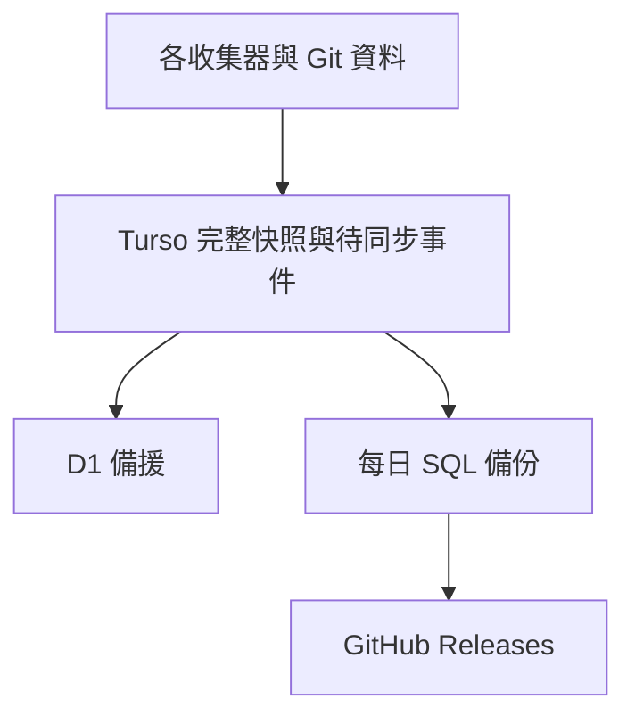

# 遊戲雷達資料庫與備份維運

## 目前整合邊界

已實作的資料流是 **各收集器的 Git 資料 → Turso 完整文件儲存 → D1 非同步備援**。
Turso 是這套資料庫儲存的唯一寫入來源，D1 只接收已提交的完整版本。
既有收集器仍以 Git JSON 交接、合併狀態及發布靜態網站；本版沒有把收集器的
所有讀寫直接切到資料庫，也不會在 Turso 故障時自動將 D1 升為另一個寫入來源。

這個邊界保留既有 Followers / growth 的三方合併、較新量測優先及 Git 發布回執。
資料庫同步有自己的排程、concurrency 與時間上限，不占用收集器鎖。



## 完整來源

來源選取規則在 `radar_backend/storage/sources.py`，每輪先固定各分支的 Git commit，
再讀取該 commit 的完整 tree 和 blobs。來源包含 JSON、JSONL、NDJSON。

| Repository / branch | 範圍 |
| --- | --- |
| `game-trend-radar` / main | `data/` 全部；含成長歷史、Twitch 每日歷史、Nintendo、YouTube、公開頁面資料 |
| `game-trend-radar-backend` / main | `data/`、`experiments/`、`reports/` |
| `game-trend-radar-backend` / steam-state | `data/`；另一路 Followers checkpoint |
| `game-trend-radar-content-backend` / main | `data/`、人工 `content_backend/descriptions_zh_tw.json` |
| `game-trend-radar-igdb-backend` / main | `data/` 全部，保留完整壓縮 master 封裝 |
| `game-trend-radar-twitch-backend` / main | `data/` 全部 |
| `game-trend-radar-youtube-backend` / main | 監看 `data/`；初始無資料檔，實際公開輸出已包含於 frontend |

2026-10-15 固定來源盤點：245 檔，原始 280,689,473 bytes；實際儲存的
gzip/base64 去重 chunks 約 39.4 MB，另外加上索引、來源清單與同步紀錄。
這是基準量測，線上資料會持續增加。沒有刪除 Twitch 歷史或縮減 IGDB 原始資料。

## 如何維持完整性

- 檔案保持原始 bytes，不經解析後重寫；中文、未知欄位、大型 ID 與格式均可還原。
- 壓縮內容以 SHA-256 定址、去重並分塊，每列低於 48 KiB。
- 同一來源的所有檔案先保存、讀回驗證，最後才以單一 CAS SQL 更新來源清單。
  SQLite trigger 在同一個交易中產生待同步事件，避免只有主資料而沒有同步紀錄。
- D1 必須讀回並驗證完整資料後才確認同步成功。失敗事件保留，後續重試可重複執行。
- 來源下載、JSON 驗證或 Git 讀取失敗時，保留上一份快照，不將失敗解讀為刪除。
- 清理只回收不被現行來源或未完成同步事件引用的暫存資料；完整歷史檔案仍在來源中。
  所有資料庫寫入、備援、匯出與清理必須使用同一個 workflow concurrency。

資料表是可攜式 SQLite 文件儲存：`radar_sources` 為來源版本，`radar_objects` /
`radar_chunks` 保存內容，`radar_outbox` 保存待同步事件，`radar_revisions` 防止同一
Git 版本被賦予不同內容。`radar_schema` 記錄 schema 版本。
這不是供前端直接 SQL 查詢的正規化遊戲資料表；前端繼續讀靜態 JSON。

## 排程與故障

Actions workflow：**Sync radar data to Turso and D1**。

- 每小時第 43 分掃描全部來源；GitHub 排程可能延遲，不是準點保證。
- Steam 每日候選、官方 Followers、成長追蹤完成後也掃描，包括有保存進度的失敗 run。
- 跨 repo 的 Twitch / IGDB / content 更新由每小時掃描補上。
- 不依賴 `GITHUB_TOKEN` 提交觸發 push；這類提交通常不會建立後續 push workflow。
- HTTP 每次最多 15 秒、最多 3 次；主庫操作總預算 25 分鐘，D1 10 分鐘，job 上限 35 分鐘。
- 每日備份先於 D1 同步執行，避免 D1 故障拖延主庫的獨立備份。
- 原始收集排程不等待資料庫；同步失敗會在獨立 workflow 顯示失敗，Git 保留已提交資料，
  下次掃描可重建當時仍存在的完整來源。兩次掃描之間被來源刪除的短暫資料不保證捕捉。

報告包含每個來源 commit / generation、同步 pending 數、主備一致性、容量與備份結果。
`events_pending = 0` 代表當輪已保存於 Turso 的事件都已同步，不代表跨來源同時刻的全域交易。
各 repo 的快照有各自擷取時間；不偽稱同一瞬間的全系統狀態。

手動 `Run workflow` 模式：

| mode | 用途 |
| --- | --- |
| `sync` | 掃描全部來源、匯入 Turso、補同步 D1、清理孤兒資料 |
| `replicate` | 不重新收集 Git，重試已有的 D1 待同步事件 |
| `verify` | 要求完整 7 個來源，逐來源還原主備資料並比對原始 bytes |
| `export` | 匯出現在的 Turso 快照，額外提供保留 1 天的下載 artifact |

需要的五個 repository Actions Secrets 沿用 `docs/turso-d1-rollout.md`。
GitHub Releases 使用 Actions 自帶的 `GITHUB_TOKEN`，不用再建立另一個 Token。

## 每日可攜式備份與還原

每個台灣日期第一個成功備份會建立 GitHub Release：`radar-storage-v1-YYYY-MM-DD`。
內含 `radar.sql.gz`、`manifest.json`、`SHA256SUMS`。SQL 是標準 SQLite SQL dump，
不依賴 Turso 帳戶；發布前先匯入新的 SQLite 檔、執行 integrity check，再驗證全部文件。
同日已完成版本不覆蓋；歷史 release 不自動刪除。這些來源原已是公開 Git 資料，備份也公開。
大量 SQL 備份放在 Releases；一般 Actions artifact 只保留小型狀態報告，避免日常佔用大量 artifact 空間。

下載備份後，在本 repo 根目錄可使用 Python 3.12 還原原始 JSON：

```bash
python -m scripts.storage_restore --sql-gzip radar.sql.gz --output restored-data
```

也可以先還原成標準 SQLite，再用任何 SQLite 工具存取；`storage_restore` 亦支援
`--sqlite radar.sqlite`。輸出目錄必須尚不存在，避免蓋掉目前資料。
工具驗證 SHA-256 與原始長度後才產生最終目錄，每個來源有獨立子目錄與還原清單。
不會執行供應商切換或部署操作。

Turso 永久無法使用時，可先取得最新 GitHub Release 或使用 D1 中已同步的資料；
重新部署與將 D1 升為收集器主來源需要另行切換 writer，不能只換 URL。

## 免費容量與後續維護

D1 Free 目前單庫 500 MB、每日 100,000 rows written，索引更新也計入寫入量。
此版使用增量去重與孤兒回收，沒有啟用任何付費方案。
chunk payload 達 300 MiB 時，workflow 會明確回報容量警示並失敗提示；該數字未包含索引等額外空間，
應同時查看 Cloudflare 控制台實際容量。到達警示時需先規劃分庫，不能靠自動刪歷史維持備援。

10/08–10/14 的 6 個完整 Twitch 日期，觀測平均每日約增加 1.84 MB gzip/base64；
若覆蓋量不變，30 天約 55 MB。這只是既有資料的推估，免費容量不是永久無限。
未來可以利用 D1 免費多庫額度分開歷史與即時資料，但本版尚未實作自動分庫。

擴大來源 prefix 或新增資料類型時，需做來源 scope 版本遷移；不能直接讓相同 Git commit
指向不同 manifest。資料表升級亦需明確 schema migration，未知版本會拒絕執行。

將收集器直接改成 DB primary 是後續獨立切換：需處理初始 hydrate、每次 merge 的最新資料來源、
跨 repo writer fencing、DB/Git 各自的回執及故障待送紀錄。這些沒有在本次改動中偷偷繞過。

## 官方參考

- https://docs.turso.tech/sdk/http/reference
- https://developers.cloudflare.com/d1/platform/limits/
- https://developers.cloudflare.com/d1/platform/pricing/
- https://docs.github.com/en/repositories/releasing-projects-on-github/about-releases
- https://docs.github.com/en/actions/concepts/security/github_token
